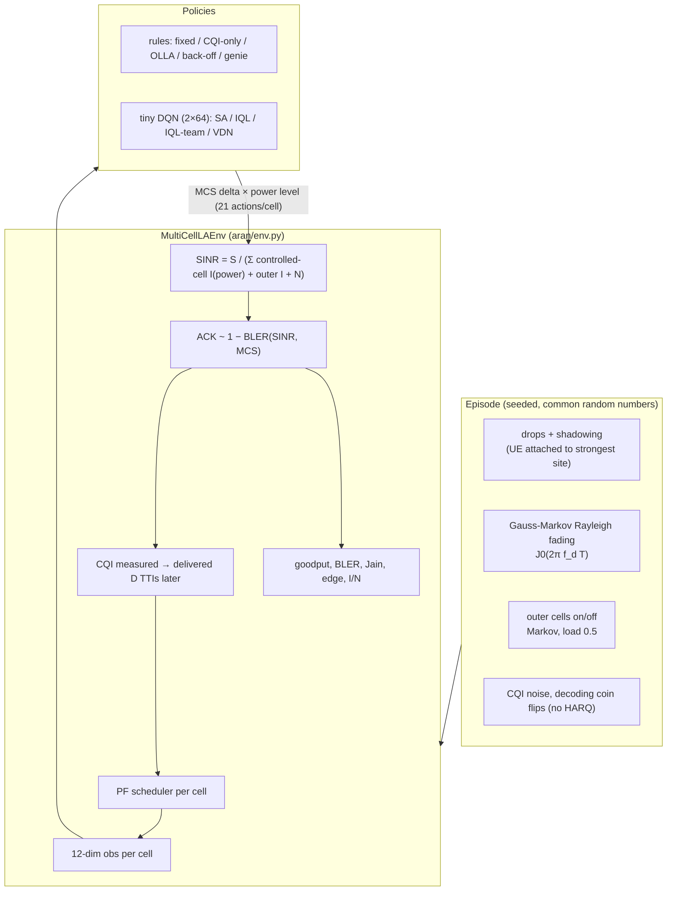
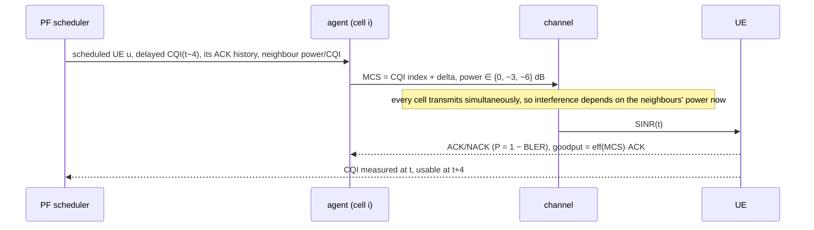
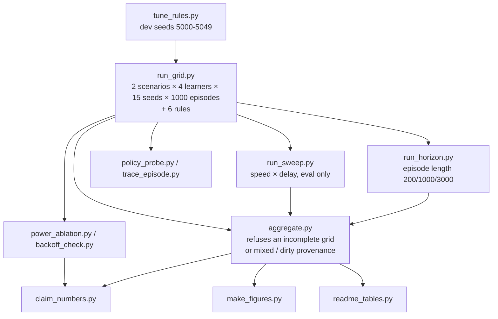
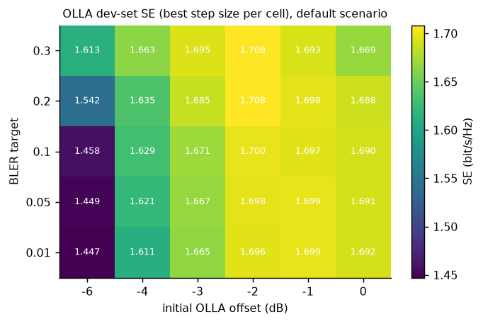

# AI-RAN link-adaptation MARL sandbox

This is a small, **CPU-only** Gymnasium + PyTorch sandbox for downlink link adaptation (choosing MCS and transmit
power) across several interfering cells. It compares rule-based outer-loop link adaptation (OLLA) with a
single-agent DQN and with independent and cooperative multi-agent RL, using 15 training seeds, 100 shared evaluation
episodes, confidence intervals and Holm-corrected tests.

> **Do not cite vendor or operator trial numbers as results of this simulator, and do not cite this simulator's
> numbers as evidence about real networks.** The project was prompted by the SoftBank and Ericsson
> [press release (20 Aug 2026)](https://www.softbank.jp/en/corp/news/press/sbkk/2026/20260820_02/) on an AI-native
> link-adaptation scheduler trial. That release reports gains measured on a live 5G network, which this toy model
> does not and cannot reproduce. Nothing here uses Ericsson or SoftBank code or data, or implies any affiliation.
> Every percentage below is a property of this toy model only.

## Headline (scoped to what was measured)

These results come from the toy model with 3 cells × 4 UEs, 200-TTI episodes, 30 km/h, a 4-TTI CQI delay and no
HARQ. Each figure is the mean over 15 training seeds × 100 evaluation episodes, with a 95% two-way bootstrap CI. A
result is called significant when its Holm-adjusted p is below 0.05 in a family of 34 tests and its CI excludes 0
([summary.json](results/summary.json), [comparisons.csv](results/comparisons.csv)).

| Spectral efficiency (bit/s/Hz per cell) | `default` | `coupled` |
|---|---|---|
| OLLA, tuned on dev episodes | 1.823 [1.757, 1.890] | 1.640 [1.584, 1.699] |
| Single-agent DQN | 1.904 [1.835, 1.972] | 1.742 [1.687, 1.802] |
| **IQL, own-cell reward** | **1.931 [1.860, 2.001]** | **1.758 [1.696, 1.816]** |
| IQL, team reward | 1.772 [1.707, 1.835] | 1.580 [1.526, 1.634] |
| VDN, team reward (cooperative) | 1.765 [1.700, 1.832] | 1.595 [1.543, 1.649] |
| Genie MCS (non-causal reference) | 2.898 [2.820, 2.976] | 2.726 [2.653, 2.801] |

1. **The learned link adaptation beat the tuned OLLA rule in both scenarios.** IQL gained +0.108 bit/s/Hz
   [+0.097, +0.118] (+5.9%) in `default` and +0.117 [+0.107, +0.127] (+7.2%) in `coupled`. Its edge-UE throughput
   rose by +9.5% and +10.4%. All 15 seeds beat OLLA in every one of these cases (Holm p = 0.0017). The single-agent
   DQN gained +4.4% and +6.2%. IQL beat it by a small but significant margin (+1.4% and +0.9%). These p-values
   condition on the 100 evaluation episodes (training seed = unit); the CIs also reflect episode sampling.
2. **The cooperative methods did worse here, not better.** IQL and VDN trained on the team reward lost about
   3% SE and 8-10% edge throughput against tuned OLLA, and about 8-10% SE against own-reward IQL, with 0 of 15
   seeds better in each case. VDN and team-reward IQL were not significantly different from each other. Power
   back-off explains part of this, not all: a [full-power ablation](#power-ablation) (same learned MCS choices,
   power forced to 0 dB) recovers 56-58% of the SE gap to IQL in `default` and 33-35% in `coupled`. The rest comes
   from their more conservative MCS offsets. This holds for this action space, reward,
   observation and one shared hyperparameter set with **no per-method tuning**. It is not a general statement
   about cooperative MARL.
3. **IQL's gain comes from per-CQI MCS offsets, not from power control.** IQL and the single-agent DQN almost always
   transmit at full power (mean back-off −0.16 and −0.22 dB), and forcing IQL to 0 dB changes its SE by only
   +0.003 (`default`) and +0.001 (`coupled`) bit/s/Hz ([ablation](#power-ablation)). An untuned, hand-set back-off
   rule (−6 dB whenever the UE reports the top CQI index) traded SE for edge throughput: −9.4% SE and +5.5% edge
   in `default`. That rule was relaxed once before aggregation
   ([protocol deviation](docs/method.md#protocol-deviations)).
4. **The gain holds across a speed × CQI-delay sweep but reverses at low mobility** (an exploratory, uncorrected
   [heatmap](#robustness-speed--cqi-delay-sweep)). IQL trails OLLA at 3 km/h for delays of 1-4 TTIs: −0.064
   [−0.099, −0.029] bit/s/Hz at a delay of 1. Longer episodes, which give OLLA more time to converge, did not close
   the gap ([horizon check](#does-the-short-episode-favour-the-learners)).


*Data: [results/methods.csv](results/methods.csv). Script: [scripts/make_figures.py](scripts/make_figures.py) `kpi_bars`.*

## Contents

- [Architecture](#architecture)
- [Environment](#environment)
- [Methods](#methods-and-baselines)
- [Results](#results)
- [What the learners learned](#what-the-learners-learned)
- [Robustness](#robustness-speed--cqi-delay-sweep)
- [Reproduce](#reproduce)
- [Tests and mutation check](#tests-and-mutation-check)
- [Limitations](#limitations-vs-commercial-ai-ran)

## Architecture







## Environment

There are 3 controlled cells on a triangle with an ISD of 500 m. Each serves 4 UEs, and a ring of 6 uncontrolled
outer cells transmits in random on/off bursts. Every TTI:

1. A PF scheduler in each cell picks one UE, using that UE's delayed and quantised CQI.
2. The cell's agent picks an MCS delta (−4 to +2) and a power back-off (0, −3 or −6 dB).
3. The SINR includes the current power of the other controlled cells. This is the coupling between agents.
4. A block succeeds with probability 1 − BLER(SINR, MCS).

The `coupled` scenario removes the outer ring and spreads UEs to 0.9 ISD, so more of the interference is under the
agents' control. All modelling choices are listed in [docs/method.md](docs/method.md).

Both configs ([config/default.json](config/default.json), [config/demo.json](config/demo.json)) use 3 cells × 4 UEs × 200-TTI
episodes; the demo only trains for fewer episodes (150). `Config` itself rejects sizes outside hard caps
(1-7 cells, 1-16 UEs per cell, 0-12 outer cells, at most 20,000 TTIs, CQI delay 0-64). A full training run (1000 episodes) took 4-5 minutes on one CPU thread on an unloaded box (up to about 22 minutes
when the box was CPU-throttled). The demo (`scripts/demo.py`, 150 episodes) took 47 s.

## Methods and baselines

| | Method | Learns? | Notes |
|---|---|---|---|
| rule | Fixed MCS | – | best of 15 on dev episodes (MCS 7) |
| rule | CQI only | – | inner loop only |
| rule | OLLA 10% | – | textbook: 10% target, 0.5 dB step, offset starts at 0 |
| rule | **OLLA tuned** | – | target 0.2, step 0.1 dB, initial offset −2 dB, chosen from 120 settings on each scenario's dev episodes, tuned separately per scenario ([heatmap](figures/dev_tuning_heatmap.png), csv: [default](results/dev_tuning_default.csv), [coupled](results/dev_tuning_coupled.csv)). Both searches picked the same setting |
| rule | OLLA tuned + back-off | – | tuned OLLA, plus −6 dB whenever the UE reports the top CQI index (14). Untuned (hand-set −6 dB / top CQI index); relaxed once, see [protocol deviations](docs/method.md#protocol-deviations) |
| ref | Genie | – | true current SINR, full power, non-causal |
| RL | Single-agent DQN | cell 0 only | neighbours run tuned OLLA during training; deployed in all cells |
| MARL | IQL | 3 cells | parameter-shared, own-cell goodput |
| MARL | IQL team | 3 cells | parameter-shared, mean goodput of all cells |
| MARL | VDN | 3 cells | Q_tot = Σ Q_i, summed team reward ([Sunehag et al., 2018](https://arxiv.org/abs/1706.05296)) |

All learners use the same network (12 → 64 → 64 → 21, about 6k parameters, `device=cpu`), double DQN with a Huber
loss, γ = 0.5 and 1000 episodes with ε decaying 1 → 0.05 over the first 600.


*Data: [results/dev_tuning_default.csv](results/dev_tuning_default.csv). Script: [scripts/tune_rules.py](scripts/tune_rules.py), [make_figures.py](scripts/make_figures.py) `tuning_heatmap`. The surface is flat: the top 10 settings are within 0.012 bit/s/Hz of each other.*

## Results

The full tables, with every KPI and all 34 comparisons, are in [docs/results_tables.md](docs/results_tables.md),
generated from [results/summary.json](results/summary.json).

![Forest plot in a 2-by-2 grid: rows are SE (10 comparisons) and edge throughput (7 comparisons), columns the two scenarios, each panel with its own x-axis and a relative-difference label per point. 33 of the 34 comparisons are significant (green = gain, red = loss); the only grey one is VDN minus team-reward IQL on SE in both scenarios. SA and IQL minus tuned OLLA are green on SE and edge, the team-reward learners minus OLLA and minus IQL are red, and the back-off rule is red on SE and green on edge.](figures/diff_forest.png)
*Data: [results/comparisons.csv](results/comparisons.csv). Script: [make_figures.py](scripts/make_figures.py) `forest`. Unit of inference: the training seed for learners (exact sign-flip test, n = 15) and the episode for rule vs rule (n = 100).*

| Comparison (`default`) | ΔSE [95% CI] | ΔEdge [95% CI] | Seeds A>B | Holm p |
|---|---|---|---|---|
| IQL − OLLA tuned | +0.108 [+0.097, +0.118] | +0.016 [+0.014, +0.018] | 15/15 | 0.0017 |
| Single-agent DQN − OLLA tuned | +0.081 [+0.070, +0.092] | +0.013 [+0.011, +0.015] | 15/15 | 0.0017 |
| VDN − OLLA tuned | −0.058 [−0.073, −0.043] | −0.015 [−0.018, −0.012] | 0/15 | 0.0017 |
| VDN − IQL | −0.166 [−0.179, −0.153] | −0.030 [−0.033, −0.028] | 0/15 | 0.0017 |
| VDN − IQL team | −0.007 [−0.023, +0.009] | – | 7/15 | 0.37 (n.s.) |
| IQL − single-agent DQN | +0.026 [+0.020, +0.033] | – | 15/15 | 0.0017 |

With 15 seeds the smallest possible exact sign-flip p is 2/2¹⁵ = 6.1e-5. The 6 rule-vs-rule tests sit at the
Monte-Carlo floor (p = 1e-5) and take the first 6 Holm steps, so the seed-level tests are multiplied by 34 − 6 = 28:
6.1e-5 × 28 = 0.0017 (× 34 would give 0.0021). That is why so many rows share the same value.


*Data: [results/curves_summary.csv](results/curves_summary.csv) (from `results/raw/*/*/curve.csv`). Script: [make_figures.py](scripts/make_figures.py) `learning_curves`. Training curves include ε = 0.05 exploration and use training episodes, so they sit below the greedy evaluation numbers.*

### Timeline of one episode


*Data: [results/trace_default.csv](results/trace_default.csv). Script: [scripts/trace_episode.py](scripts/trace_episode.py), [make_figures.py](scripts/make_figures.py) `timeline`. A single episode, shown for illustration only.*

### Interference and collision proxies


*Data: [results/methods.csv](results/methods.csv); the quoted ranges are in [results/claim_numbers.json](results/claim_numbers.json) (`proxies`), from [scripts/claim_numbers.py](scripts/claim_numbers.py). Script: [make_figures.py](scripts/make_figures.py) `proxies`.*

## What the learners learned

![Two rows of heatmaps for tuned OLLA and the four learners in the default scenario. The top row shows the distribution of MCS index minus reported CQI index for each CQI index, and the bottom row the distribution of power level for each CQI index. Tuned OLLA's mean offset is 0, −1.0 and −1.4 at CQI indices 0-2, then about −1.4 to −2.1. SA and IQL move from about +1.2 to +1.4 at CQI index 0 to about −1.9 at index 13 and use 0 dB in 94-96% of TTIs. VDN picks −6 dB in 55-63% of TTIs at CQI indices 0-3, falling to 6% at index 10 and 5% at index 14.](figures/actions_default.png)
*Data: [results/policy_actions.csv](results/policy_actions.csv); per-index means and shares in [results/claim_numbers.json](results/claim_numbers.json) (`actions`). Script: [scripts/policy_probe.py](scripts/policy_probe.py), [make_figures.py](scripts/make_figures.py) `action_heatmaps`. The coupled scenario is in [figures/actions_coupled.png](figures/actions_coupled.png).*

The own-reward learners act like a CQI-dependent OLLA offset that they keep across episodes. They are more
aggressive than OLLA at low CQI index (mean offset +1.4 at index 0 for IQL) and more conservative at high CQI index
(−1.9 at index 13), where OLLA applies about −1.4 to −2.1 above index 2 ([data](results/claim_numbers.json)). The
team-reward learners also learned to "sacrifice" weak UEs, backing off power when their own UE has a low CQI index.
Under the summed-goodput reward that is a locally sensible credit assignment, but in this model it costs more than
the neighbours gain. The ablation below shows how much of their deficit that explains.

### Power ablation

![Two panels (default, coupled) of per-seed SE for IQL, team-reward IQL and VDN, each deployed as learned (circles) and with the same MCS choices but power forced to 0 dB (squares), with thin lines pairing each seed and black bars at the means; a dotted line marks IQL's mean. IQL barely moves (+0.003 and +0.001). Team-reward IQL rises from 1.726 to 1.817 and VDN from 1.717 to 1.815 in default, and from 1.564 to 1.623 and 1.577 to 1.628 in coupled; every one of the 15 seeds improves, but both stay below IQL.](figures/power_ablation.png)
*Data: [results/power_ablation.csv](results/power_ablation.csv). Script: [scripts/power_ablation.py](scripts/power_ablation.py), [make_figures.py](scripts/make_figures.py) `power_ablation_plot`. First 30 evaluation episodes, 15 seeds; exploratory, no tests.*

Forcing full power recovers 0.091 of the 0.161 bit/s/Hz gap to IQL for team-reward IQL and 0.098 of 0.170 for VDN
in `default` (56% and 58%), and 0.059 of 0.168 and 0.051 of 0.156 in `coupled` (35% and 33%). So power back-off
explains roughly a third to three fifths of the team-reward deficit; the rest comes from their MCS choices, which
are more conservative than IQL's at every CQI index in `default` ([fractions](results/claim_numbers.json), `power_ablation`).

## Robustness: speed × CQI-delay sweep

![Four heatmaps over UE speed (3-120 km/h) and CQI delay (1-16 TTIs). (1) Tuned OLLA minus CQI-only is positive except at 3-10 km/h with short delay. (2) IQL minus OLLA is positive in 20 of 25 cells (19 with a CI above 0), up to +0.14, and has a CI below 0 at 3 km/h for delays of 1, 2 and 4. (3) VDN minus OLLA is negative in 24 of 25 cells (23 with a CI below 0), down to −0.47 at 3 km/h. (4) The single-agent DQN is positive in 18 cells and negative in 7 (16 and 6 with CIs excluding 0). The training point, 30 km/h with a 4-TTI delay, is boxed.](figures/sweep_heatmap.png)
*Data: [results/sweep_summary.csv](results/sweep_summary.csv) (from `results/raw/sweep/`). Script: [scripts/run_sweep.py](scripts/run_sweep.py), [make_figures.py](scripts/make_figures.py) `sweep_heatmaps`. This is evaluation only, on 30 episodes. Learners were trained at the boxed point only, and OLLA keeps its dev tuning. Asterisks mark 95% CIs that exclude 0. They are uncorrected and exploratory; cell counts are in [results/claim_numbers.json](results/claim_numbers.json) (`sweep`).*

## Does the short episode favour the learners?

OLLA restarts from its initial offset every episode, and a UE gets only about 50 transmissions in 200 TTIs. The
learners, by contrast, carry a prior learned across episodes. To check whether that favours them, every policy was
re-evaluated with longer episodes:


*Data: [results/horizon_summary.csv](results/horizon_summary.csv) (from `results/raw/horizon/`). Script: [scripts/run_horizon.py](scripts/run_horizon.py), [make_figures.py](scripts/make_figures.py) `horizon_plot`.*

The gap did not close: IQL − OLLA was +0.119 [+0.099, +0.138] at 200 TTIs and +0.181 [+0.172, +0.190] at 3000. The
textbook 10%-target OLLA gets worse as its offset converges. So in this model, without HARQ, a 10% BLER target is
simply the wrong operating point.

## Reproduce

```bash
python3.13 -m venv .venv && . .venv/bin/activate
pip install --index-url https://download.pytorch.org/whl/cpu torch==2.14.1+cpu
pip install -r requirements-lock.txt --extra-index-url https://download.pytorch.org/whl/cpu   # pinned versions used for the results
pytest                                 # CPU only, ~15 s
python scripts/demo.py                 # seed-reproducible short run: 150 episodes of IQL vs rules (47 s measured here)

# full experiment (all on CPU; ~75-110 min with 7 workers on 8 vCPUs as measured here)
for sc in default coupled; do python scripts/tune_rules.py --scenario $sc; done
python scripts/run_grid.py --workers 7            # blocks until the grid is done
python scripts/run_sweep.py --workers 7 && python scripts/run_horizon.py --workers 7
python scripts/trace_episode.py && python scripts/policy_probe.py
python scripts/power_ablation.py && python scripts/backoff_check.py
python scripts/aggregate.py                       # exits 2 and writes nothing if anything is missing, extra or of mixed provenance
python scripts/claim_numbers.py && python scripts/readme_tables.py && python scripts/make_figures.py
python scripts/mutation_check.py                  # ~5-10 min with MUT_WORKERS=6
```

`run_grid.py`, `run_sweep.py` and `run_horizon.py` write a `meta.json` (code hash, git state, config, tuned rule
parameters) next to every output and skip an output only when it is up to date; an output with missing or stale
provenance is an error unless `--force`. The committed raw results predate this; their metas were backfilled only
after regenerating a sample and finding it byte-identical ([record](results/provenance_check.json),
[docs/method.md](docs/method.md#reproducibility-guards)). Every number in this README comes from the committed files
under `results/`. Regenerating the figures from them gives byte-identical PNGs.

## Tests and mutation check

- **107 pytest tests** ([tests/](tests/)) cover:
  - PHY tables, the BLER curve, CQI-index mapping and the genie argmax
  - env reset/step invariants: shapes, observation space, episode termination, seed determinism, common random
    numbers, best-cell attachment, SINR against a hand computation, power coupling, CQI delay, the
    reference-power measurement, the ACK rule, PF behaviour, the action codec, outer-cell load and burst length,
    fading power and correlation, the KPIs, the observation features and the `Config` caps
  - OLLA update maths, convergence to the target BLER on a slow channel, and the back-off trigger
  - the DQN and VDN TD targets checked by hand, terminal masking, target-network syncing and training determinism
  - **pipeline wiring** ([tests/test_pipeline.py](tests/test_pipeline.py)): a spy on `env.reset` during training
    for every learner (every episode seed is a training seed, none is dev or eval); `tune_rules` touches only dev
    seeds and records them; a grid job evaluates on the eval seeds, writes `meta.json`, skips only when up to date
    and refuses stale or missing provenance; the committed results use the eval episodes; a causal-observation test
    (perturbing future fading, outer-cell activity, CQI noise and decoding draws leaves earlier observations
    unchanged and changes later ones); CQI is measured with the neighbours' actual power; replay marks only the
    last step terminal; the deployed policy applies the learned power and delta; an end-to-end `summarise()` on a
    synthetic grid (Holm over 34, the paired CI, the relative-% base, ties not counted as wins); `compare()` refuses
    unpaired episodes
  - the stats: exact and Monte-Carlo sign-flip tests, Holm, and the crossed bootstrap
  - the aggregate guard (missing, unexpected or empty raw; mixed code hash; dirty tree; tuning or config mismatch;
    no partial mode) and the provenance hash; `make_figures.py` exits 2 on an incomplete summary; `run_grid.py`
    rejects an unknown scenario
  - a CPU demo smoke test
- **Mutation check**: [scripts/mutation_check.py](scripts/mutation_check.py) first runs the unmutated copy (107
  passed), then applies 82 single-line bugs to a throw-away copy, for example "ACK probability inverted", "CQI
  report not delayed", "VDN mixes by mean", "seed 0 trains on eval episodes", "no Holm correction", "aggregate
  accepts mixed code hashes" and the reviewer's 16 (R1-R16: learners train on eval episodes, grid evaluates on dev
  seeds, OLLA tuned on eval episodes, future-CQI leaks, ties as wins, Holm per scenario, …). A mutant counts as
  killed only if `pytest` exits 1. **82/82 killed** ([results/mutation_check.json](results/mutation_check.json)).
  The reviewer's own harness, run unchanged against this tree, kills 14 of 16
  ([results/mutation_reviewer_r1.json](results/mutation_reviewer_r1.json)); R2 and R3 no longer apply verbatim
  because those call sites were refactored (`eval_seeds()`, `tune(seeds=…)`), and their adapted versions are in
  the 82.

## Limitations vs commercial AI-RAN

- This is a toy abstraction: flat fading, one wideband CQI, an LTE CQI table, a logistic BLER curve, **no HARQ**,
  full buffer, one UE per TTI, 3 cells, no MIMO/rank, no frequency-selective scheduling, no handover and
  independent shadowing. Real link adaptation works on NR MCS tables with HARQ, rank and CSI, and with many more
  users.
- The neighbour features assume an idealised, instant X2-style exchange of power and scheduled-UE CQI.
- The learners share a single hyperparameter set with no per-method search. Different credit assignment (QMIX,
  MAPPO, reward shaping) or tuning could change the cooperative ranking. Our claim covers only what was run.
- The OLLA baseline was tuned on each scenario's dev set, but only over its 3 parameters. A per-CQI offset table
  (what the learners effectively found) is a rule a vendor could also hand-tune.
- The reward is goodput only. Fairness enters only through the PF scheduler; no learner is rewarded for edge
  throughput or Jain fairness, so edge gains are a side effect.
- The speed × delay sweep and the horizon check are evaluation-only and exploratory.
- A first version of the back-off rule (top CQI index **and** OLLA top MCS) never fired under tuned OLLA. That was
  first seen on the evaluation episodes; it also fires 0 times on the dev episodes in both scenarios
  ([results/backoff_strict_check.csv](results/backoff_strict_check.csv)), so dev data would have led to the same
  change. It was relaxed to "top CQI index" and re-run before aggregation. The strict rule's results are in git
  history for `default` only (c0fe3c6). Details: [protocol deviations](docs/method.md#protocol-deviations).

## Layout

```
aran/        env.py (Gymnasium env) · phy.py · policies.py (rules) · agents.py (DQN/IQL/VDN) · stats.py · scenarios.py
scripts/     tune_rules · run_grid · run_sweep · run_horizon · trace_episode · policy_probe · power_ablation · backoff_check · backfill_meta · aggregate · claim_numbers · readme_tables · make_figures · mutation_check · demo
results/     raw/ (per-run eval/curve CSVs + model.pt) · summary.json · *.csv
figures/     all PNGs above        docs/  method.md · results_tables.md · pilot/ (the one pilot run)
```

No license has been chosen yet; that is the repository owner's decision.
